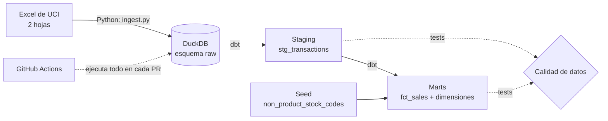
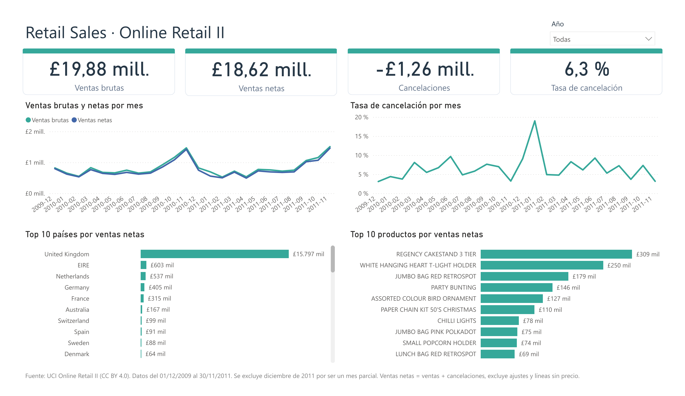

# retail-sales-dbt-duckdb


End-to-end ELT pipeline on the UCI Online Retail II dataset: Python ingestion, DuckDB storage, dbt transformations, data quality tests and CI with GitHub Actions.

> **Estado:** pipeline funcional y automatizado, con dashboard en Power BI.

**English summary:** Python loads the two sheets of the Online Retail II Excel file into DuckDB (raw layer, all text). dbt cleans and types them (staging), removes a 22,523-row overlap between sheets and builds a star schema (`fct_sales`, `dim_products`, `dim_date`). Data quality tests run on every pull request in GitHub Actions.

## Objetivo

Construir de punta a punta un flujo de datos sobre transacciones reales de una tienda en línea, tratando los problemas de calidad que trae el dataset (hojas solapadas, cancelaciones, ajustes de inventario, códigos que no son productos), y dejar un modelo listo para responder preguntas de negocio como:

- ¿Cuánto se vende por mes, en bruto y neto de cancelaciones?
- ¿Qué países generan más ingresos?
- ¿Cuáles son los productos más vendidos, sin contar envíos ni comisiones?
- ¿Cuál es la tasa de cancelación por mes?

## Arquitectura



| Capa | Contenido | Materialización |
|---|---|---|
| **raw** | Una tabla por hoja del Excel, tal como llegó (todo como texto) | Tablas |
| **staging** | Nombres claros, tipos convertidos, unión de las dos hojas sin el solape | Vistas |
| **marts** | Modelo en estrella listo para análisis | Tablas |

### Modelo dimensional

- **Hecho:** `fct_sales`, una fila por línea de factura, con `line_total` (cantidad por precio) y `transaction_type`.
- **Dimensiones:** `dim_products` (una fila por código de producto, con una marca `is_product` y un `item_type`) y `dim_date`.
- **Seed:** `non_product_stock_codes`, la lista de códigos que no son mercadería (envíos, comisiones, ajustes, descuentos, muestras, pruebas y vales de regalo).

El país se mantiene como columna de `fct_sales`, porque solo hay 43 valores y no tienen atributos propios: una dimensión aparte solo agregaría un join. No hay `dim_customers`: del cliente solo se tiene su ID, sin atributos propios, así que una dimensión no agregaría información. Los análisis por cliente se hacen directamente sobre `fct_sales`, excluyendo las líneas sin `customer_id`.

## Stack

- **Python** (pandas, openpyxl) para la ingesta
- **DuckDB** como almacén analítico local
- **dbt-core** (adaptador `dbt-duckdb`) para transformaciones, seeds y tests
- **GitHub Actions** para ejecutar el pipeline en cada Pull Request
- **Git / GitHub** para control de versiones
- **Power BI** para la visualización

## Dataset

Chen, D. (2012). *Online Retail II* [Dataset]. UCI Machine Learning Repository. https://doi.org/10.24432/C5CG6D

Licencia del dataset: [CC BY 4.0](https://creativecommons.org/licenses/by/4.0/). Contiene las transacciones de una tienda en línea del Reino Unido entre el 01/12/2009 y el 09/12/2011: 1.067.371 filas en dos hojas de un Excel.

Los datos **no se incluyen en este repositorio**. Se descargan desde UCI. Se transforman en las capas staging y marts de este proyecto (renombrado de columnas, conversión de tipos, unión de hojas, clasificación de transacciones y cálculos).

El código de este repositorio se distribuye bajo licencia MIT (ver `LICENSE`). La licencia del dataset aplica únicamente a los datos.

## Estructura del repositorio

```
.
├── .github/workflows/ci.yml   # pipeline automático
├── data/                      # datos descargados y convertidos (no versionado)
├── docs/                      # capturas del dashboard
├── ingestion/
│   └── ingest.py              # Excel -> CSV -> DuckDB (esquema raw)
├── dbt_project/
│   ├── dbt_project.yml
│   ├── profiles.yml
│   ├── models/
│   │   ├── staging/           # fuentes, modelos por hoja, unión y tests
│   │   └── marts/             # fct_sales, dim_products, dim_date y tests
│   ├── seeds/                 # non_product_stock_codes
│   └── tests/                 # tests propios (totales de filas y limpieza de códigos)
├── requirements.txt
└── README.md
```

## Cómo ejecutarlo

**1. Clonar el repositorio y crear el entorno**

```bash
git clone https://github.com/LuisEnrique98/retail-sales-dbt-duckdb.git
cd retail-sales-dbt-duckdb
python -m venv .venv
.venv\Scripts\activate        # Windows
source .venv/bin/activate     # Linux / Mac
pip install -r requirements.txt
```

**2. Descargar el dataset**

Crear la carpeta `data/raw/` (no viene en el repositorio):

```bash
mkdir -p data/raw             # Linux / Mac
mkdir data\raw                # Windows
```

Descargar el ZIP desde [UCI](https://archive.ics.uci.edu/dataset/502/online+retail+ii) y extraer `online_retail_II.xlsx` en `data/raw/`.

**3. Cargar los datos crudos a DuckDB**

Desde la raíz del proyecto:

```bash
python ingestion/ingest.py
```

Convierte cada hoja del Excel a CSV (la primera vez tarda varios minutos) y crea `retail.duckdb` con una tabla `raw` por hoja. Los CSV ya convertidos se omiten en las ejecuciones siguientes.

**4. Transformar y probar con dbt**

```bash
cd dbt_project
dbt seed --profiles-dir .
dbt run --profiles-dir .
dbt test --profiles-dir .
```

El pipeline completo también se ejecuta automáticamente en GitHub Actions en cada Pull Request.

## Decisiones de diseño

- **ELT en lugar de ETL:** `raw` es una copia fiel del Excel (todo como texto) y las transformaciones ocurren dentro de DuckDB con dbt, lo que deja cada paso trazable.
- **Una tabla `raw` por hoja:** la unión es una transformación, así que se hace en staging y no al cargar.
- **Capas separadas:** `raw` queda intacto, `staging` solo ordena y tipifica, y la lógica de negocio vive en `marts`.
- **Limpieza de `stock_code` y `description`:** se aplica `trim` y `upper()` en el paso final de `stg_transactions`, después de quitar el solape, para que códigos que solo difieren en espacios o mayúsculas (por ejemplo `47503J` y `47503J `, o `M` y `m`) no se traten como distintos. Se hace al final para no alterar la deduplicación entre hojas.
- **Granularidad a nivel de línea de factura:** permite analizar por producto, país y fecha, y calcular el ticket por factura.
- **Clasificación de transacciones:** `transaction_type` separa ventas, cancelaciones, ajustes y líneas sin precio, para que los ingresos brutos y netos no se mezclen con movimientos que no son ventas.
- **Descripción de cada producto:** cuando un código tiene varias descripciones, se elige la que aparece en más líneas con precio, luego la más frecuente, luego la más reciente, y por último el orden alfabético, para que el resultado sea siempre el mismo.
- **Precios:** se usan tal como vienen en el dataset (libras). El dataset no indica si incluyen impuestos, y no se calcula ningún IGV ni equivalente.
- **Ingesta idempotente:** `CREATE OR REPLACE TABLE` permite repetir la carga sin duplicar datos.

## Calidad de datos

Tests en dbt: no nulos, unicidad de claves en las dimensiones, integridad referencial entre el hecho y sus dimensiones, valores aceptados en `transaction_type` e `item_type`, y tres tests propios: dos que verifican los totales de filas y uno que comprueba que los códigos de producto no tengan espacios ni minúsculas.

**Hallazgos**

| Hallazgo | Detalle |
|---|---|
| Hojas solapadas | Las dos hojas coinciden del 01/12/2010 al 09/12/2010: 22.523 filas idénticas. Se conserva una sola copia: 1.067.371 − 22.523 = **1.044.848** filas, verificado con un test |
| Códigos que no son productos | Envíos (`POST`, `DOT`, `C2`), comisiones, ajustes, descuentos, muestras, pruebas y vales de regalo. Se clasifican con un seed |
| Descripciones empatadas | 5 códigos tenían dos descripciones igual de frecuentes. Se resuelven con la regla de desempate descrita arriba |
| Líneas negativas sin factura "C" | 3.393 líneas, todas con precio 0 y sin cliente. De ellas, 2.633 no tienen descripción y las demás traen notas como `damaged`, `missing` o `check`. Se tratan como ajustes de inventario |
| Código `B` (deuda incobrable) | 6 líneas con importes grandes, cinco negativos y uno positivo. Se tratan como ajustes contables |
| Líneas con precio 0 y cantidad positiva | 2.631 líneas, solo 70 tienen cliente. Se clasifican aparte como `zero_price` |
| Factura "C" con cantidad positiva | 1 caso, se marca como `cancellation_anomaly` |
| Espacios y mayúsculas en los códigos | El código `47503J` aparecía duplicado por un espacio al final, y había variantes que solo diferían en mayúsculas (por ejemplo `M` y `m`). Se normalizan en staging y un test verifica que `dim_products` no tenga códigos sin limpiar |
| Pico de cancelaciones en enero de 2011 | La tasa llega al 19 % frente al 3-10 % del resto de los meses. Una sola venta de 74.215 unidades (£77.184) se canceló 16 minutos después, y eso infla a la vez las ventas brutas y las cancelaciones del mes. Sin ese par, la tasa sería de cerca del 8,8 %. Entre las demás cancelaciones del mes hay cargos `AMAZONFEE` y ajustes manuales (`M`), que entran como cancelaciones |

**Líneas por `transaction_type`**

| Tipo | Líneas |
|---|---|
| `sale` | 1.019.653 |
| `cancellation` | 19.164 |
| `adjustment` | 3.399 |
| `zero_price` | 2.631 |
| `cancellation_anomaly` | 1 |
| **Total** | **1.044.848** |

**Limitaciones:** la clasificación de ajustes y de líneas sin precio se infiere de los datos y de sus descripciones, y no se pudo confirmar con quien generó el dataset. Hay líneas sin `customer_id`, por lo que cualquier análisis por cliente no las incluiría. Las ventas y cancelaciones incluyen cargos que no corresponden a mercadería, como envíos, comisiones y ajustes manuales. El análisis por producto, en cambio, excluye estos cargos.

## Dashboard

Dashboard en Power BI sobre `fct_sales`, `dim_products` y `dim_date`, exportados desde DuckDB. Responde las cuatro preguntas de negocio. Esta etapa es manual y no forma parte del pipeline automatizado.



**Definiciones**

- **Ventas brutas:** líneas de tipo `sale`.
- **Ventas netas:** `sale` + `cancellation`, excluye ajustes y líneas sin precio.
- **Tasa de cancelación:** cancelaciones sobre ventas brutas.
- **Periodo:** del 01/12/2009 al 30/11/2011. Se excluye diciembre de 2011 por ser un mes parcial.

Las cifras del dashboard se validaron contra consultas SQL en DuckDB.

## Resultados

- **Ventas por mes:** entre diciembre de 2009 y noviembre de 2011 se vendieron £19,88 millones brutos y £18,62 millones netos de cancelaciones. Noviembre es el mes más alto en ambos años (£1,47 millones en 2010 y £1,51 millones en 2011, en ventas brutas).
- **Países:** United Kingdom concentra cerca del 85 % de las ventas netas (£15,8 millones). Le siguen EIRE (£603 mil), Netherlands (£537 mil), Germany (£405 mil) y France (£315 mil).
- **Productos:** los más vendidos son `REGENCY CAKESTAND 3 TIER` (£309 mil), `WHITE HANGING HEART T-LIGHT HOLDER` (£250 mil) y `JUMBO BAG RED RETROSPOT` (£179 mil), contando solo artículos que son mercadería.
- **Cancelaciones:** el 6,3 % de las ventas brutas se canceló. Mes a mes se mantiene entre el 3 % y el 10 %, salvo enero de 2011, que llega al 19 % por una sola venta cancelada (ver Calidad de datos).

## Roadmap

- [x] Ingesta a DuckDB (una tabla raw por hoja)
- [x] Capa staging, unión de hojas y tests de calidad
- [x] Modelo dimensional (marts) y clasificación de transacciones
- [x] Automatización con GitHub Actions
- [x] Dashboard

## Autor

**Luis Enrique Allcca Alarcón** — Data Analyst | Data Engineering  
[LinkedIn](https://www.linkedin.com/in/luis-enrique-allcca-alarcon) · [GitHub](https://github.com/LuisEnrique98)

## Licencia

Código bajo licencia [MIT](LICENSE). Dataset bajo [CC BY 4.0](https://creativecommons.org/licenses/by/4.0/).